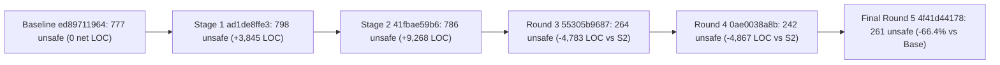

# Final Design and Rationale: Multi-Round `unsafe` Refactoring in `mmtk-core`

Five engineering rounds refactored the `mmtk-core` garbage-collector framework from the `ed89711964` baseline commit to the `4f41d44178` (`4f41d4417885cb6935f3c784aa5148fbd2805bc0`) `master` commit. The refactoring audited all 322 `.rs` files under Rust 1.84. It cut code `unsafe` items by 66.4% (`777` to `261`) and cut `unsafe impl` items by 91.9% (`62` to `5`). In total, 80.4% of `.rs` files (`259` of `322`) now contain zero `unsafe` code.

---

## 1. Executive Summary and Multi-Round Trajectory

The refactoring progressed through two initial containment stages and three structural simplification rounds. Stage 1 (`ad1de8ffe3`) documented safety invariants inside folder boundaries and promoted unchecked helpers to `unsafe fn` contracts. Stage 2 (`41fbae59b6`) introduced cross-folder capability wrappers, which stalled total `unsafe` items at `786` and added `9,268` net lines of code (LOC). Rounds 3 through 5 replaced those wrappers with garbage-collector-native ownership types. Those three rounds cut `525` `unsafe` items (`-66.8%`) and `4,691` net LOC relative to Stage 2.

### 1.1 Multi-Round Milestone Metrics

| Milestone (`master` SHA) | Code `unsafe` | Prod (`{} / fn / impl / tr`) | Test and Bench (`{} / fn / impl / tr`) | `unsafe {}` | `unsafe fn` | `unsafe impl` | `unsafe trait` | Zero-`unsafe` `.rs` Files | Net LOC vs Baseline |
| :--- | ---: | :---: | :---: | ---: | ---: | ---: | ---: | :---: | ---: |
| Baseline (`ed89711964`) | `777` | `572` (`426 / 98 / 48 / 0`) | `205` (`191 / 0 / 14 / 0`) | `617` | `98` | `62` | `0` | `194 / 322` (`60.2%`) | `0` |
| Stage 1 (`ad1de8ffe3`) | `798` | `668` (`480 / 172 / 15 / 1`) | `130` (`127 / 1 / 2 / 0`) | `607` | `173` | `17` | `1` | `233 / 322` (`72.4%`) | `+3,845` |
| Stage 2 (`41fbae59b6`) | `786` | `584` (`393 / 174 / 17 / 0`) | `202` (`200 / 1 / 1 / 0`) | `593` | `175` | `18` | `0` | `238 / 327` (`72.8%`) | `+9,268` |
| Round 3 (`55305b9687`) | `264` | `211` (`142 / 63 / 6 / 0`) | `53` (`51 / 1 / 1 / 0`) | `193` | `64` | `7` | `0` | `256 / 322` (`79.5%`) | `+4,485` (`-4,783` vs S2) |
| Round 4 (`0ae0038a8b`) | `242` | `195` (`130 / 60 / 5 / 0`) | `47` (`45 / 1 / 1 / 0`) | `175` | `61` | `6` | `0` | `260 / 322` (`80.7%`) | `+4,401` (`-4,867` vs S2) |
| Final Round 5 (`4f41d44178`) | `261` | `200` (`132 / 64 / 4 / 0`) | `61` (`57 / 3 / 1 / 0`) | `189` | `67` | `5` | `0` | `259 / 322` (`80.4%`) | `+4,577` (`-4,691` vs S2) |
| **Final Delta vs Baseline** | **`-516` (`-66.4%`)** | **`-372` (`-65.0%`)** | **`-144` (`-70.2%`)** | **`-428` (`-69.4%`)** | **`-31` (`-31.6%`)** | **`-57` (`-91.9%`)** | **`0`** | **`+65` files (`+20.2 pp`)** | **`+4,577`** |

On the final `4f41d44178` commit, raw `\bunsafe\b` matches across `.rs` files fell from `802` to `282` (`261` code tokens plus `21` comment mentions). The final diff spans `200` files (`14,438` insertions and `9,861` deletions). That `+4,577` net LOC delta adds `# Safety` contracts and `// SAFETY:` proofs on all `261` items, regression tests, and `0.34.0` migration notes.

### 1.2 Per-Subsystem Slice Outcome (`ed89711964` to `4f41d44178`)

| Subsystem Slice | Baseline (`Prod + Test` \| `{} / fn / impl / tr`) | Stage 2 (`41fbae59b6`) | Final (`Prod + Test` \| `{} / fn / impl / tr`) | Net Delta vs Baseline |
| :--- | :---: | ---: | :---: | ---: |
| `meta` (`src/util/metadata/**`, `bulk_meta/**`) | `297` (`174 + 123` \| `261 / 36 / 0 / 0`) | `295` | `117` (`90 + 27` \| `84 / 33 / 0 / 0`) | `-180` (`-60.6%`) |
| `util` (`src/util/**`, `tests/test_address.rs`) | `97` (`78 + 19` \| `78 / 12 / 7 / 0`) | `115` | `55` (`46 + 9` \| `38 / 15 / 2 / 0`) | `-42` (`-43.3%`) |
| `heap` (`src/util/heap/**`, `mock_bench/**`) | `67` (`64 + 3` \| `43 / 15 / 9 / 0`) | `33` | `5` (`4 + 1` \| `5 / 0 / 0 / 0`) | `-62` (`-92.5%`) |
| `policy` (`src/policy/**`, `alloc/**`, `copy/**`) | `143` (`143 + 0` \| `111 / 26 / 6 / 0`) | `244` | `24` (`24 + 0` \| `22 / 2 / 0 / 0`) | `-119` (`-83.2%`) |
| `plan` (`mmtk.rs`, `plan/**`, `scheduler/**`) | `91` (`91 + 0` \| `60 / 7 / 24 / 0`) | `33` | `15` (`15 + 0` \| `6 / 7 / 2 / 0`) | `-76` (`-83.5%`) |
| `vm` (`src/vm/**`, `test_util/**`, `docs/dummyvm/**`) | `82` (`22 + 60` \| `64 / 2 / 16 / 0`) | `66` | `45` (`21 + 24` \| `34 / 10 / 1 / 0`) | `-37` (`-45.1%`) |
| `Other` (crate root and integration harnesses) | `0` (`0 + 0` \| `0 / 0 / 0 / 0`) | `0` | `0` (`0 + 0` \| `0 / 0 / 0 / 0`) | `0` (`0.0%`) |
| **Total (`322` `.rs` files)** | **`777` (`572 + 205` \| `617 / 98 / 62 / 0`)** | **`786`** | **`261` (`200 + 61` \| `189 / 67 / 5 / 0`)** | **`-516` (`-66.4%`)** |

### 1.3 Why Round 5 Added `+19` Honest `unsafe` Tokens (`242` to `261`)

Round 5 ran a zero-prior cold audit (`r5-cold-audit`) across all `199` changed files on `0ae0038a8b`. That audit found two `unsafe`-laundering gaps and one removable `unsafe impl` item:

- **Unchecked non-atomic byte loads in `MetadataByteArrayRef::get`**. In [global.rs](../../src/util/metadata/side_metadata/global.rs#L1721-L1796), the external `MetadataByteArrayRef` wrapper checked spec geometry with debug-only assertions. Its safe `pub fn get` method then executed non-atomic raw byte loads. Round 5 upgraded `MetadataByteArrayRef::new` to unconditional overflow-safe `assert_eq!` checks. It also promoted `MetadataByteArrayRef::get` to `pub unsafe fn` (`+1` `unsafe fn` and `+1` unit-test `unsafe {}` block).
- **Raw metadata address helpers in `SideMetadataSpec` and `test_private`**. In [global.rs](../../src/util/metadata/side_metadata/global.rs#L362-L533) and [mod.rs](../../src/util/test_private/mod.rs#L30-L80), `zero_meta_bits` and `set_meta_bits` accepted raw metadata addresses under safe signatures. Round 5 promoted all four functions and the `bulk_update_metadata` callback parameter to `unsafe fn` contracts (`+5` `unsafe fn`). Callers in `global.rs`, `test_private`, `side_metadata_tests.rs`, and `bzero_bset.rs` added `+13` `unsafe {}` blocks.
- **Removable `Zeroable` implementation on `AtomicSpaceDescriptor`**. In [space_descriptor.rs](../../src/util/heap/space_descriptor.rs#L40-L46) and [map32.rs](../../src/util/heap/layout/map32.rs#L35-L42), one startup allocation in `Map32::new` relied on `unsafe impl Zeroable for AtomicSpaceDescriptor`. Replacing that call with `std::iter::repeat_with` removed `-1` `unsafe impl` item and lowered `unsafe impl` count from `6` to `5`.

Accepting `+20` explicit `unsafe` annotations alongside `-1` removed `unsafe impl` item yielded the final `261` count with zero `unsafe` laundering.

---

## 2. Architectural Post-Mortem: Ceremonial Wrappers vs Intrinsic GC Structure

Comparing Stage 2 (`41fbae59b6`) against Rounds 3 through 5 (`4f41d44178`) shows why type-level proof ceremony failed where garbage-collector-native data structures succeeded.

### 2.1 Why Stage 2 Ceremonial Wrappers Failed (`786` `unsafe`, `+9,268` LOC)

Stage 2 attempted to encode runtime phase protocols as zero-sized capability tokens layered over unchanged raw-pointer storage. That approach created six high-overhead wrapper families without shrinking the trusted computing base:

- **Phase-token cells (`471` LOC)**. `PhaseCell`, `StwCell`, `PlanPhaseAuth`, and `PlanMutLeaseGuard` minted stop-the-world proof tokens so pauses could form `&mut dyn Plan` borrows. However, `&'static dyn SFT` entries still aliased spaces inside the concrete `Plan` struct at the same time.
- **Global worker-permission registries (`460` LOC)**. `WorkerLocalSlice`, `WorkerPerm`, `MmtkId`, and `MINTED_WORKER_COUNTS` tracked per-instance worker ordinals across six files to serve a single LXR remembered-set buffer (`MatureEvecRemSet`).
- **Solo-stage scheduler wrappers (`450` LOC)**. `SoloStageWork`, `SoloStageFactory`, `SoloPacketRunner`, `SoloExecutionGuard`, and `SoloWorkerToken` duplicated `WorkBucket` scheduling logic just to run one packet before opening a stage.
- **Raw mutator tickets (`231` LOC, `10` `unsafe` items)**. `MutatorTicket(NonNull<Mutator<VM>>)` wrapped `&'static mut Mutator<VM>` pointers in manual `Send` impls and raw dereferences even though `Mutator<VM>` already satisfied `Send + 'static` in safe Rust.
- **Parallel typed metadata and address newtypes (`550+` LOC)**. `TypedSideSpec`, `BitWidth`, and `MetadataCodec` (`347` LOC) duplicated `SideMetadataSpec` APIs, and `NonZeroAddress` plus `AlignedAddress` wrapped `NonNull<u8>` with four manual `Send` and `Sync` impls.
- **Typestate block mirrors in `policy` (`143` to `244` `unsafe` items)**. `SweptBlock`, `UnsweptBlock`, `UnsweptBlockLists`, `MappedBlock`, `MallocExclusiveChunk`, and `MallocChunkTables` forced repeated `unsafe` conversions at every space, allocator, and side-metadata seam.

### 2.2 Five GC-Native Abstractions That Succeeded (`786` to `261` `unsafe`, `-4,691` LOC)

Rounds 3 through 5 removed every ceremonial layer listed in Section 2.1 and restructured storage around five invariants already native to MMTk:

- **Niche-optimized `Option<&'static Space>` in `Allocators<VM>` and `GCWorkerCopyContext<VM>`**. Safe `MAX_*`-element `Option<Allocator>` arrays replaced `MaybeUninit<Allocator>` unions in [allocators.rs](../../src/util/alloc/allocators.rs#L34-L90) and [mod.rs](../../src/util/copy/mod.rs#L53-L90). Allocators in [bumpallocator.rs](../../src/util/alloc/bumpallocator.rs#L19-L65) and [free_list_allocator.rs](../../src/util/alloc/free_list_allocator.rs#L32-L75) store `Option<&'static Space>` using the non-null niche. `Allocators<VM>` keeps its `648 B` 64-bit size (`324 B` on 32-bit), and `Mutator<VM>` keeps identical field offsets. `BumpAllocator<VM>` also keeps its `48 B` (`0x30`) array stride with zero `unsafe` blocks in `allocators.rs` or `copy/mod.rs`.
- **Linear `!Copy` `OwnedBlock` tokens in `native_ms`**. Copyable `Block` IDs stay separate from `!Copy` `OwnedBlock` handles in [block.rs](../../src/policy/marksweepspace/native_ms/block.rs#L23-L320) and [block_list.rs](../../src/policy/marksweepspace/native_ms/block_list.rs#L33-L120). Moving blocks by value removed three side-metadata link specs (`MS_BLOCK_LIST`, `MS_BLOCK_PREV`, and `MS_BLOCK_TLS`). `#[repr(C)]` `BlockList` shrank from `32 B` (`24 B` in Stage 2) to `16 B` (`8 B` on 32-bit). That design cut `native_ms` from `87` `unsafe` items to `11`.
- **Inline `OnceLock<SFTMapImpl>` storage and `Fin<N>` bounded indices**. In [sft_map.rs](../../src/policy/sft_map.rs#L10-L150) and [fin.rs](../../src/util/rust_util/fin.rs#L14-L55), `SFT_MAP_OWNER` (`OnceLock<SFTMapImpl>`) stores the space-function table inline. That layout removes `Box<dyn SFTMap>` indirection, `SFT_MAP_FAST_PTR` globals, and `UnsafeCell` wrappers. `Fin<N>` witnesses prove index bounds a single time so safe indexing compiles to branchless lookups, cutting `sft_map.rs` to `3` `unsafe` items.
- **Shared `&self` pause hooks, `WorkersParked`, `pre_open_hook`, and safe `erase_vm`**. `MarkState` (`AtomicU8`) in [mark_bit.rs](../../src/util/metadata/mark_bit.rs#L37-L80) and `AtomicCopySemantics` let all 11 plans run `prepare` and `release` hooks via `&self` without `&mut Plan` aliases. `HasSpaces::for_each_space_static` in [global.rs](../../src/plan/global.rs#L1148-L1210) made `GCTrigger::set_plan` in [gc_trigger.rs](../../src/util/heap/gc_trigger.rs#L67-L85) completely safe. Pause coordination uses `WorkersParked` in [worker_monitor.rs](../../src/scheduler/worker_monitor.rs#L46-L70) and `WorkBucket::pre_open_hook` in [work_bucket.rs](../../src/scheduler/work_bucket.rs#L156-L195). LXR buffering uses `GCWorker::lxr_evac_slots` in [worker.rs](../../src/scheduler/worker.rs#L103-L115), and packets store `Option<&'static mut Mutator<VM>>` in [gc_work.rs](../../src/scheduler/gc_work.rs#L115-L355). Finally, [erase_vm.rs](../../src/util/erase_vm.rs#L17-L31) downcasts `&'a mut (dyn Any + 'static)`, leaving `0` `unsafe` items across `src/scheduler/**`.
- **Unified `AtomicMetaRef<'a, T>`, release-acquire base atomics, and atomic grain slices**. In [metadata_val_traits.rs](../../src/util/metadata/metadata_val_traits.rs#L311-L408), `AtomicMetaRef<'a, T>` (`Full` and `SubByte`) unified atomic loads, stores, CAS, and RMW loops across header and side metadata. In [layout.rs](../../src/util/metadata/side_metadata/layout.rs#L34-L155), `SIDE_METADATA_RESERVED_BYTES` and `SIDE_METADATA_BASE_PTR` check side-metadata bounds via a single `Acquire` pointer load without `OnceLock` branches. Mapped `&[AtomicU8]` and `&[AtomicUsize]` grain slices back `scan_vo_bits_atomic` in [mod.rs](../../src/util/metadata/vo_bit/mod.rs#L404-L470) and `MallocSpace::chunk_vo_bytes` in [global.rs](../../src/policy/marksweepspace/malloc_ms/global.rs#L587-L625). Those atomic slices also back Immix tables in [block.rs](../../src/policy/immix/block.rs#L362-L425) and `MappedOVCRegion` in [forwarding.rs](../../src/policy/ovc/forwarding.rs#L88-L130).

---

## 3. Taxonomy of Intrinsic vs Incidental `unsafe`

### 3.1 Incidental `unsafe` Categories Removed (`-516` Net Items)

Five categories of incidental `unsafe` code disappeared across the five rounds:

- **Manual `Send`, `Sync`, `PodInOption`, and `Zeroable` trait impls (`62` to `5`, `-91.9%`)**. Atomics, `Mutex`, `RwLock`, `OnceLock`, `AtomicRefCell`, and `+ Sync` trait bounds replaced `UnsafeCell`, `RefCell`, and raw pointers. Those replacements let `rustc` derive `57` trait impls automatically.
- **Mutable globals (`3` `static mut` items to `0`)**. Two `VM_LAYOUT` globals and one `MOCK_VM_INSTANCE` global moved to atomic pointers and `OnceLock` singletons.
- **Unchecked lifetime extensions (`'a` to `'static` `transmute` calls)**. `Space::acquire` no longer transmutes `&self` borrows into `'static` SFT trait objects, and `erase_vm` uses safe `Any` subtyping. `MockVM` also replaced its eight-site `lifetime!` `transmute` macro with higher-ranked `MockMethodFn` closures.
- **Uninitialized unions and custom allocation shims**. Safe `Option` niches, `OnceLock`, and `bytemuck` helpers replaced `MAX`-element `MaybeUninit` allocator arrays, `OnceOptionBox`, `InitializeOnce`, `RevocableBox`, and `zeroed_alloc`.
- **Multi-layer `unsafe fn` call pyramids**. Safe checked entry points discharge raw address and mapping preconditions a single time at the hardware or OS boundary. As a result, `src/scheduler/**`, `object_enum.rs`, `rc.rs`, `gc_trigger.rs`, `map32.rs`, and `csm` contain `0` `unsafe` items.

### 3.2 Complete Inventory of the Remaining `261` Intrinsic `unsafe` Items

All `261` remaining `unsafe` items (`200` production and `61` test or benchmark items across `63` `.rs` files) sit at the zero-laundering floor. Pushing that count lower without breaking frozen `pub` signatures would require disguising raw dereferences, OS syscalls, or C FFI calls behind unsound safe wrappers.

| Intrinsic Cluster (Slice) | Files | `unsafe fn` | `unsafe impl` | `unsafe {}` | Total (`Prod + Test`) | Irreducible Boundary |
| :--- | ---: | ---: | ---: | ---: | :---: | :--- |
| Side, header, VO-bit, and log-bit metadata (`meta`) | `12` | `33` | `0` | `84` | `117` (`90 + 27`) | `SideMetadataSpec`, `MetadataValue`, `HeaderMetadataSpec`, `MetadataByteArrayRef::get`, `&[AtomicU8]` grain projection, and bulk benchmarks |
| Raw `Address`, `ObjectReference`, and slab primitives (`util`) | `8` | `11` | `0` | `18` | `29` (`26 + 3`) | Frozen `Address` and `ObjectReference` memory loads/stores, pointer provenance casts, `memory::set`, and `RawMemoryFreeList` `&[AtomicI32]` slab |
| OS virtual memory, C `malloc`, `OpaquePointer`, and `test_private` (`util`) | `7` | `4` | `2` | `20` | `26` (`20 + 6`) | `mmap`, `munmap`, `mprotect`, `prctl`, `madvise`, `sched_setaffinity`, `calloc`/`posix_memalign`/`free`, `OpaquePointer`, and `test_private` bit helpers |
| Heap virtual-address layout constants (`heap`) | `4` | `0` | `0` | `5` | `5` (`4 + 1`) | Compile-time `VMLayout` bounds, `Map64` space base calculation, `SpaceDescriptor::get_start`, and synthetic `mmapper` benchmark addresses |
| Policy spaces, allocators, and SFT atomics (`policy`) | `10` | `2` | `0` | `22` | `24` (`24 + 0`) | `OwnedBlock` intrusive free cells, `malloc_ms` FFI calls, `SFTRefStorage` fat-pointer atomics, Immix/OVC mapped slices, Lisp2 forwarding cells, and alignment fill |
| `MMTK<VM>`, `Mutator` FFI delegates, and LXR sweep (`plan`) | `4` | `7` | `2` | `6` | `15` (`15 + 0`) | `MMTK<VM>: Send + Sync`, `MMTK::get_plan_mut` (`UnsafeCell<dyn Plan>`), `6` frozen `pub unsafe fn` `Mutator` methods, and LXR dead-object payload zeroing |
| `ObjectModel`, `SimpleSlot`, `DummyVM` C FFI, and `MockVM` (`vm`) | `18` | `10` | `1` | `34` | `45` (`21 + 24`) | `ObjectModel` metadata defaults, `SimpleSlot` raw heap slots, `7` `pub unsafe extern "C" fn` C entry points, `MutatorHandle`, and explicit `Address::from_usize` tests |
| **Total (`259 / 322` zero-`unsafe` `.rs` files)** | **`63`** | **`67`** | **`5`** | **`189`** | **`261` (`200 + 61`)** | **100% intrinsic to GC memory management, OS/C FFI, or frozen VM-binding contracts** |

Rust's type system requires each of the five remaining `unsafe impl` items:

1. **`MMTK<VM>: Send` and `MMTK<VM>: Sync` (`2` impls)**. In [mmtk.rs](../../src/mmtk.rs#L142-L147), `MMTK<VM>` owns `Box<UnsafeCell<dyn Plan<VM = VM>>>` for the frozen `pub unsafe fn get_plan_mut` escape hatch and `WorkersParked` pause hooks.
2. **`OpaquePointer: Send` and `OpaquePointer: Sync` (`2` impls)**. In [opaque_pointer.rs](../../src/util/opaque_pointer.rs#L9-L25), `#[repr(transparent)] pub struct OpaquePointer(*mut c_void)` crosses C FFI thread-local-storage boundaries by value.
3. **`MutatorHandle: Sync` (`1` test-only impl)**. In [vm.rs](../../src/util/test_util/mock_vm/vm.rs#L423-L438), frozen `VMBinding` traits require `&'static mut Mutator<MockVM>` borrows during stop-the-world root scans. Owning mutator threads check atomic owner and park flags before forming fast-path references.

---

## 4. Soundness, Logic, Concurrency, and 32-Bit Bugs Found and Fixed

Auditing every `unsafe` contract and removing wrapper indirection uncovered ten classes of pre-existing or latent bugs, each covered by regression tests:

- **Unmasked bit clobbering and invalid RMW load orderings in `AtomicMetaRef`**. In [metadata_val_traits.rs](../../src/util/metadata/metadata_val_traits.rs#L70-L77) and [metadata_val_traits.rs](../../src/util/metadata/metadata_val_traits.rs#L368-L408), masked full-width `compare_exchange` passed unmasked `old_val` and `new_val` into `Atomic::compare_exchange`. That call failed spuriously or clobbered adjacent header bits, while `Release` or `AcqRel` orderings panicked in `fetch_update`. Masking both operands against preserved bits and mapping RMW load orderings through `load_order_for_rmw` fixed both defects.
- **`524,288x` redundant `MMAPPER` calls per 4 MiB grain in `vo_bit` scanning**. In [mod.rs](../../src/util/metadata/vo_bit/mod.rs#L404-L470), object-by-object `VO_BIT` scanning called `MMAPPER.is_mapped` `524,288` times per 4 MiB chunk. Checking `is_mapped` per metadata grain and scanning `&[AtomicU8]` with 8-byte zero-skip reads removed that bottleneck. Subsequent `Acquire` byte loads preserve happens-before ordering with `set_vo_bit`.
- **Off-heap `get_unchecked` UB and weak-memory ordering in `SFT` dispatch**. Out-of-range `ObjectReference::is_live` and `SFTTrace::trace_object` queries triggered `get_unchecked` UB in [sft.rs](../../src/policy/sft.rs#L115-L140) and [address.rs](../../src/util/address.rs#L794-L830). `Relaxed` fat-pointer loads in [sft_map.rs](../../src/policy/sft_map.rs#L10-L150) also lacked ARM64 release-acquire synchronization. `Fin<N>` checked indexing and `Release`/`Acquire` `SFTRefStorage` atomics closed both holes.
- **Offset-malloc `usable_size` overshoot, prefix underflow, and 32-bit/`jemalloc` alignment bugs**. In [malloc_ms_util.rs](../../src/util/malloc/malloc_ms_util.rs#L7-L155) and [global.rs](../../src/policy/marksweepspace/malloc_ms/global.rs#L365-L380), `malloc_usable_size(raw)` ignored `result_offset`. `MallocSpace` then marked adjacent chunks in `SFT_MAP` and `ChunkMap`. In addition, `align == 4` offset allocations under-allocated the 8-byte base-pointer prefix on 64-bit. Zero-offset `align <= 16` calls also used `calloc` on 32-bit glibc (`8 B` alignment) and 8-byte `jemalloc` classes. Reserving `align + BYTES_IN_ADDRESS`, subtracting `result_offset`, and routing `align > BYTES_IN_ADDRESS` to `posix_memalign` fixed all three bugs.
- **Data races in `MMTK::enumerate_objects` and `Address::is_field_logged`**. Safe `pub fn enumerate_objects` in [mmtk.rs](../../src/mmtk.rs#L579-L595) read `VO_BIT` through non-atomic `u8` loads alongside atomic mutator stores. Similarly, `is_field_logged` in [address.rs](../../src/util/address.rs#L433-L445) read `GLOBAL_FIELD_UNLOG_BIT_SPEC` non-atomically alongside concurrent barrier RMWs. Both methods now use atomic byte loads.
- **macOS `dzmmap` unconditional `MAP_FIXED` overwrite**. In [macos.rs](../../src/util/os/imp/unix_like/macos.rs#L16-L65), `macos::dzmmap` passed `replace: true` (`MAP_FIXED`) even when `strategy.replace` was `false`, silently overwriting existing mappings. It now omits `MAP_FIXED` when `!strategy.replace`, checks the returned address against `start`, and unmaps with an error on mismatch.
- **32-bit `0x8000_0000` signed-offset overflow, top-chunk `[0xffc0_0000, 2^32)` wrap, and `AtomicU64` spec alignment**. Offsets spanning `0x8000_0000` overflowed `isize` in [address.rs](../../src/util/address.rs#L130-L165). On `[0xffc0_0000, 2^32)`, `start + bytes` wrapped to `0` in [mod.rs](../../src/util/heap/layout/mmapper/csm/mod.rs#L296-L340). In [layout.rs](../../src/util/metadata/side_metadata/layout.rs#L20-L30), 4-byte word alignment also misaligned `AtomicU64` side metadata on x86-32. `checked_add_signed`, wrap-safe chunk arithmetic, and `SIDE_METADATA_SPEC_ALIGN = 8` fixed all three 32-bit hazards.
- **Zero-length null pointer UB in `memory::set` and `memory::zero`**. In [memory.rs](../../src/util/memory.rs#L4-L30), calling `std::ptr::write_bytes` with `Address::ZERO` and `len == 0` triggered Rust precondition UB. `memory::set` now returns immediately when `len == 0` and asserts `!start.is_zero()` before calling `write_bytes`.
- **Non-moving space lifecycle and empty-region iteration bugs**. In [global.rs](../../src/plan/global.rs#L1094-L1135), `CommonPlan::release_nonmoving_space` called `self.nonmoving.prepare()` instead of `release()`. Nursery collections also swept `nonmoving` pages into accounting underflow, while `ConcurrentImmix` and `Lisp2` omitted non-moving hooks. In [monotonepageresource.rs](../../src/util/heap/monotonepageresource.rs#L263-L290), `MonotonePageResource::iterate_allocated_regions` emitted a 0-byte region on empty blocks. Fixing those lifecycles and adding `mock_test_nonmoving_gc.rs` closed all four defects.
- **Dropped deferred concurrent packets in `GCWorkScheduler` and `BlockPool::pop` serialization**. In [scheduler.rs](../../src/scheduler/scheduler.rs#L91-L135), `process_concurrent_packets_in_pause` drained active concurrent packets without draining `inactive_queue`, stranding deferred packets across pauses. In [blockpageresource.rs](../../src/util/heap/blockpageresource.rs#L304-L355), `BlockPool::pop` acquired `upgradeable_read()`, serializing concurrent fast-path pops until replaced by optimistic `.read()` pops with `.write()` refill fallback.

---

## 5. Anti-Laundering Guardrails, Crate-Wide Lints, CI Checks, and Migration Notes

### 5.1 Permanent Crate-Wide Lints, MSRV `1.84`, and Review Protocol

Both [Cargo.toml](../../Cargo.toml#L13-L110) and [Cargo.toml](../../docs/dummyvm/Cargo.toml#L6-L38) pin `rust-version = "1.84"` with `resolver = "3"`. Both manifests also enforce four permanent compiler and Clippy lints across all targets:

- `unsafe_op_in_unsafe_fn = "deny"` under `[lints.rust]`, requiring narrow inner `unsafe {}` blocks inside every `unsafe fn` body.
- `undocumented_unsafe_blocks = "deny"`, `missing_safety_doc = "deny"`, and `unnecessary_safety_doc = "deny"` under `[lints.clippy]`, requiring exact `// SAFETY:` and `# Safety` proofs without stale safety docs on safe functions.

Every branch had to pass dual adversarial reviews (`safety` and `anti-laundering`) across three gates. Gate 1 checked Stacked/Tree Borrows, ARM64 memory ordering, 32-bit arithmetic, and MSRV `1.84`. Gate 2 checked net LOC discipline and banned internal workflow jargon. Gate 3 banned `unsafe` laundering, including `Address::ZERO + raw` integer fabrication, single-threaded test `*_atomic` swaps, and safe functions with unverified caller preconditions. Round 5 then ran a five-gate cold audit over the entire `ed89711964..4f41d44178` diff, reaching `0` defects.

### 5.2 Full-Matrix CI and x86-64 Release Assembly Checks

The final codebase passed every static, dynamic, documentation, and code-generation check:

- **Lint, style, and documentation gates**. `.github/scripts/ci-check-lineends.sh`, `cargo fmt --check`, and `.github/scripts/ci-doc.sh` (`-D warnings -D missing_docs --document-private-items`, `mygc_semispace`, and `mdbook`) passed cleanly. Full `.github/scripts/ci-style.sh` also passed with `0` warnings across all `32` non-exclusive and `7` mutually exclusive features on dev, release, test, bench, `macros`, and `docs/dummyvm` targets.
- **Unit and integration test matrix**. `cargo test --lib` (`577` passed, `578` with `vo_bit,extreme_assertions`), `8/8` `for_all_features` sweeps, `perf_counter` tests, and `bzero_bset` benchmark tests passed. All **`247/247` `ci-test.sh` integration suite runs** (`430` `MockVM` executions across all `47` `mock_test_*.rs` modules and all `11` GC plans) also passed with `0` failures.
- **Release x86-64 assembly checks**. Disassembly of `libmmtk_dummyvm.so` and `libmmtk.rlib` showed zero fast-path calls in `BumpAllocator::alloc` (`add`, `cmp`, and `mov`). `Allocators` indexing kept its `48 B` (`0x30`) `BumpAllocator` stride and single-instruction niche checks (`cmp QWORD PTR [rdi+rax+0x18], 0x0`). `BlockList` compiled to `16 B` (`2 * usize`), `assert_spec::<T>()` constant-folded to `0` instructions, and `global_side_metadata_base_address()` compiled to a single `mov rdx, QWORD PTR [SIDE_METADATA_BASE_PTR]` load.

### 5.3 Summary of `0.34.0` VM-Binding Migration Notes

The [prefix.md](../../docs/userguide/src/migration/prefix.md#L33-L120) guide documents all external adjustments introduced for `0.34.0`:

- **`SideMetadataSpec` and `MetadataByteArrayRef` non-atomic reads**. `SideMetadataSpec::load_byte`, `SideMetadataSpec::scan_non_zero_values`, and `MetadataByteArrayRef::get` are now `pub unsafe fn` contracts. Bindings that need safe concurrent reads should call `SideMetadataSpec::load_atomic::<u8>`.
- **`BlockList` `#[repr(C)]` size reduction**. `BlockList` in `native_ms` shrank from `32 B` (`4 * usize` in `0.33.0`, `24 B` in Stage 2) to `16 B` (`2 * usize` on 64-bit, `8 B` on 32-bit) as `[Option<OwnedBlock>, Option<Block>]`. Bindings that hardcode `FreeListAllocator` field layouts in C headers or JIT constants must update that size.
- **Module-private fields on `Allocators`, `FreeListAllocator`, and `GCWorkerCopyContext`**. `Allocators<VM>`, `FreeListAllocator<VM>`, and `GCWorkerCopyContext<VM>` made their internal allocator array and block-list fields module-private while keeping `Mutator<VM>` inline sizes and byte offsets unchanged. Bindings should call `Allocators::get_allocator`, `Allocators::get_allocator_mut`, `GCWorkerCopyContext::alloc_copy`, and `GCWorkerCopyContext::post_copy`.
- **`DummyVM` C FFI reference signatures**. Seven raw-pointer functions in [api.rs](../../docs/dummyvm/src/api.rs#L28-L195) are now `pub unsafe extern "C" fn` items with `# Safety` contracts. Those functions are `mmtk_set_option_from_string`, `mmtk_set_fixed_heap_size`, `mmtk_init`, `mmtk_destroy_mutator`, `mmtk_alloc`, `mmtk_post_alloc`, and `mmtk_start_worker`.
